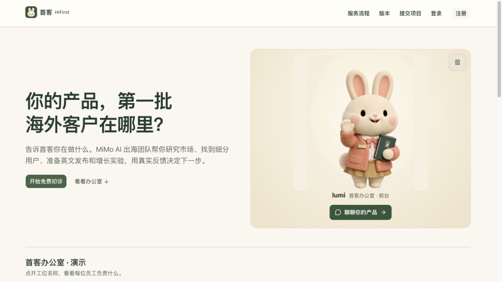

# 首客 HiFirst

帮中国开发者找到产品在英语市场的第一批用户。

首客是一间由经营者带领 AI 员工工作的出海办公室：先做免费市场初诊，再按项目推进定位、英文验证页、渠道行动与增长复盘。AI 负责研究和起草，经营者与客户确认关键决定，结果保留来源、任务状态和审批记录。

[在线体验](https://hifirst.vercel.app/) · [注册账号](https://hifirst.vercel.app/register) · [提交项目](https://hifirst.vercel.app/projects/new) · [开发与部署说明](firstcustomer/README.md)



## 当前功能

- **Lumi 动态接待**：前台兔子 lumi（露米）会挥手、点头。点击兔子打开 AI 对话，聊产品阶段和出海问题，也可以直接进入免费初诊。
- **Lumi 引导登记**：新建项目时一次回答一项，阶段与目标可快捷选择，选填项可跳过。支持本地草稿续填、截图上传和摘要修改，核对提交后开始免费初诊。
- **需求版本与工作包核验**：需求卡与补充回答保留历史，每个范围最多三轮澄清；交付前核对实际成果、审批、到账和复盘判据，旧版本确认无法覆盖新成果。详见[使用与核验说明](docs/requirements-and-verification.md)。
- **客户注册与登录**：支持邮箱、密码和「我的项目」。登录后提交的项目归入自己的账号；访客仍可通过项目专属链接跟进。
- **Free 市场初诊**：提交产品信息后自动开始研究，整理候选人群、初诊摘要和待验证项。
- **Pro 项目服务**：初诊后可申请报价；客户接受报价、经营者确认到账后，继续定位、英文验证页、渠道实验和复盘。
- **经营者办公室**：六个部门展示真实任务状态，支持审批、打回、暂停、重试、任务板、每日站会、周报与公司卷宗导出。
- **共享资料库**：内置 14 篇服务与工作规范，支持文字和 Markdown/TXT 导入、草稿与发布、角色权限、到期停用、版本历史及检索预览。Lumi 和相关 Agent 读取各自可用的发布资料，详见[资料库使用说明](docs/knowledge.md)。
- **证据与经营记录**：对外声明绑定证据，记录真实访问和留资，分别统计首客实收与客户产品线索。

## 如何体验

1. 打开首页，点击 lumi，介绍你的产品或选择一个开场问题。
2. 注册并登录后提交项目，或以访客身份提交并保存项目专属链接。
3. 等待免费初诊完成，在项目页查看结果、回答追问。
4. 如需继续，可申请 Pro 报价；后续定位和发布需要经营者与客户确认。

官网中的办公室是演示入口；实际项目操作位于需要经营者登录的 `/admin`。

## 六个部门

| 部门 | 工作内容 |
| --- | --- |
| 前台 | Lumi 接待、整理初诊结果、起草报价与项目客服 |
| 市场研究室 | 查找需求、竞品定价、付费信号与反面证据 |
| 战略决策室 | 比较目标人群，形成定位和实验计划 |
| 财务室 | 读取付款截图，等待经营者核对实际到账 |
| 产品发布室 | 制作英文验证页、渠道文案与发布材料 |
| 增长运营室 | 分析真实访问、回复和留资，给出复盘结论 |

## 技术栈

| 层级 | 实现 |
| --- | --- |
| Web | Next.js 16 App Router、React 19、TypeScript |
| 界面 | Tailwind CSS 4、shadcn/ui、Base UI、Lucide |
| 客户账号 | Better Auth，邮箱与密码登录 |
| AI | 服务器端直连 Xiaomi MiMo，支持工具调用和备用模型配置 |
| 数据 | PostgreSQL、Drizzle ORM；线上使用 Neon |
| 后台任务 | pg-boss 保存任务；本机独立 Worker，线上由 Vercel Queues 唤起执行 |
| 部署 | Vercel、GitHub `main` 自动部署，保留 Docker Compose 方案 |

## 本地运行

需要 Node.js 22.12 或以上版本及 npm。应用位于仓库内的 `firstcustomer/` 子目录。

```bash
git clone https://github.com/kongleiwork-art/firstcustomer.git
cd firstcustomer/firstcustomer
npm ci
cp .env.example .env.local
```

在 `.env.local` 中填写本机使用的 `ADMIN_PASSWORD` 和至少 32 字符的 `SESSION_SECRET`。密钥可用 `openssl rand -base64 32` 生成。暂时没有 MiMo Key 时，启用模拟模型：

```dotenv
LLM_PROVIDER=stub
ALLOW_STUB=1
```

在应用目录开三个终端，按顺序运行：

```bash
# 终端 1：本机 PostgreSQL，不需要 Docker
npm run db:dev
```

```bash
# 终端 2：建表并启动后台任务
npm run db:migrate && npm run worker
```

```bash
# 终端 3：启动网站
npm run dev
```

打开 [本机首页](http://localhost:3100) 或 [经营台](http://localhost:3100/admin)。模拟模式用于体验项目工作流，输出会标注为示例；Lumi 的自由对话需要真实模型。

接入 MiMo 时，在 `.env.local` 填写 `MIMO_API_KEY`，移除两行模拟模型配置，并重启网站和 Worker。Key 由服务器读取，访客无需提供自己的 Key。配置细节见 [应用开发文档](firstcustomer/README.md#模型配置)。

## 自动部署

当前 GitHub 仓库已连接 Vercel 项目 `hifirst`：

- 生产分支：`main`
- Root Directory：`firstcustomer`
- 正式网址：[hifirst.vercel.app](https://hifirst.vercel.app/)
- 推送或合并到 `main` 后自动构建，成功后更新正式网站；构建失败时保留当前线上版本。

数据库迁移需要独立执行，涉及表结构的更新请按 [Vercel 部署说明](firstcustomer/README.md#vercel--neon) 操作。环境变量、云端队列和 Docker 配置也在该文档中。

## 仓库结构

```text
firstcustomer/       Next.js 应用、数据库迁移、Worker 和测试
brand/               品牌兔子原始素材与形象说明
docs/images/         README 使用的页面截图
PRODUCT.md           产品定位、用户与能力约束
DESIGN.md            视觉设计说明
首客_*.md            产品需求、验收与路演材料
```

常用开发命令在 `firstcustomer/` 中执行：

```bash
npm run typecheck
npm run lint
npm test
npm run build
```

## 使用边界

当前版本是 JUNCTION CHINA 2026 · Xiaomi MiMo OPC 项目的 MVP，需求背景见 [PRD V4.2](首客_FirstCustomer_产品需求规格说明书_V4.2.md)，功能以当前代码为准。首客不保证带来付费客户或收入；收款截图需要经营者核对，发布经过审批，没有数据时如实显示样本不足。
