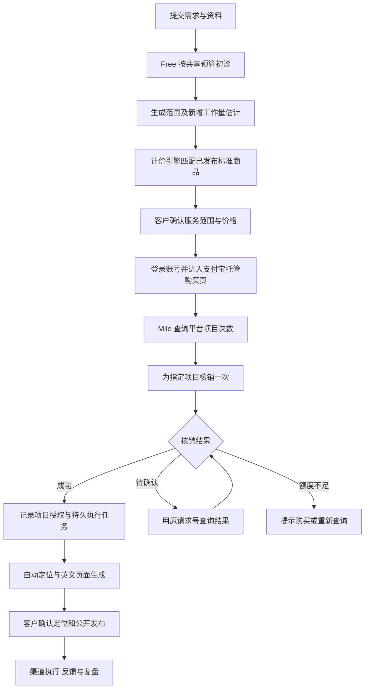

**首客 Free / Pro 成本、报价与即刻收购买方案**

方案日期：2026-11-08。状态：业务与实现方案，尚未接入即刻收或完成真实交易验证。

依据：用户提供的《Free 市场初诊：资料上传与解析上限 V1》《Pro 费用估算：MiMo 计费底座 V1》，以及[即刻收直连接入指南](https://aipay.alipay.com/docs/vibe-pay/nowpay/direct/nowpay-direct.html)。金额示例是预算复算，不是实际模型账单或已经确定的售价。

建议采用：**Free 限额初诊 → 按项目范围估算成本 → 匹配已发布的服务商品 → 客户购买项目次数 → 系统核销并绑定项目 → 自动执行。** 标准订单不经过老板申请审批、逐单批价或截图核款。

计价引擎负责成本与服务适配；对客售价来自已经发布的套餐目录。即刻收可以实现自动购买和权益处理，但不能将购买接口用作传入任意临时报价的收银台。若未来需要每笔订单精确按公式计算到分并直接收取该金额，应换用支持订单金额的支付产品，保留同一套计价和项目模型。

**两份材料分别承担什么作用**

| 材料 | 保留的核心 | 本方案中的调整 |
| --- | --- | --- |
| Free 上限方案 | 文件接收上限与入模上限分开；所有材料共享预算；超额内容明确标为未完整读取 | 将约 ¥0.05 明确为特定 Batch 输入假设下的费用，另控输出、搜索、重试及存储；免费初诊不默认调用完整 Pro 流程 |
| Pro 计费底座 | 缓存命中 / 未命中、输出、搜索分别计费；重试预算；基础设施；加价倍率及套餐底价；费率版本留存 | 标准服务取消默认老板审核工时；报价时估算付费阶段的增量工作；支付手续费、平均客服与 Free 获客分摊单独核算 |
| 即刻收 | 支付、项目次数、扣次结果由可信平台接口处理 | 首期只配置一个标准项目商品、一个“1 次”档位；不搭建积分钱包，不购买全账号永久权益 |

**Free：保留资料上限，增加完整的 AI 资源预算**

用户附件中的接收、解析规则继续作为设计输入：

| 资料 | 接收上限 | Free 完整解析上限 |
| --- | --- | --- |
| Markdown | 10 MB / 文件 | 约 0.2 MB 文本 |
| HTML | 10 MB / 文件 | 约 0.5 MB 原文件，清理后按实际文本量计 |
| DOC / DOCX | 20 MB / 文件 | 约 1.5 MB 文件，抽取文本另计 |
| 图片 | 5 MB / 张，最多 50 张 / 项目 | 降至不超过 1 MP 后，按实际图片输入用量分配共享预算 |

以上是拟采用的产品上限，不代表当前上传和解析功能已经全部实现。文件大小、文本 token 密度和图片 token 折算不能混为一项，特别是图片每张约 1.3K token 仍需要实际调用校准。

建议采用以下项目级限制：

- 保留 96K 累计输入设计预算及 196K 输入熔断线，回答补充、重复解析和重试均计入同一项目，不在每轮对话重新发放。
- 新增输出上限、搜索次数上限和人民币资源预算。首期可用“8K 累计输出、最多 3 次新增付费搜索、约 ¥0.30 设计预算、¥0.50 硬上限”作为待实测参数；实际使用还需满足输入和金额两种限制，先触及者生效。
- 费用上限覆盖模型与搜索实际消耗；存储、网络及运营成本另行计入完整经营成本。重试系数仅用于预算预测，实际支出按各次调用累加，不再乘一次重试系数。
- 已有、有效且相关的资料优先复用。额度不足时交付已有摘要、未知项与未读取范围，不假装已经完整分析，也不自动向客户扣费。
- 将随问答轮数增长的 `N × 200MB` 存储规则，调整为固定的项目总量控制。首期建议总量 200 MB，与单文件和图片数量上限同时生效；扩容另作明确服务规则。
- 新客户免费次数及频率由规则限制。超限不进入老板审批队列，直接说明可用额度和可选的付费服务。

费用复算：96K Flash Batch 未命中输入约 ¥0.048；同量实时输入约 ¥0.096，两者均未包含输出与搜索。按附件的海外搜索费率、汇率 7.1，96K 实时输入、8K 输出、3 次搜索，加 1.25 预算系数约为 ¥0.273；输入增至 196K 时约 ¥0.398。这些示例支持上述预算作为初始参数，不构成真实项目成本保证。

客户等待的初诊优先使用 Flash 实时；预约处理或离线任务可另走 Batch 并说明等待预期。MiMo 当前官方说明 Batch 按实时价格的 50% 计费，并安排在夜间闲时调度，因此不能把 Batch 的成本和实时完成体验同时作为默认承诺。[MiMo Batch 说明与费率](https://mimo.mi.com/docs/zh-CN/quick-start/usage-guide/text-generation/batch-api)

大文件按私有存储直传、索引与异步解析设计；当前页面请求大小限制需要独立处理，不能仅修改表单上显示的文件上限。

**Pro：模型预算与销售报价分开保存**

成本预测延续用户材料中的口径：

```text
C_token  = Σ(未命中输入 × 对应单价 + 命中输入 × 对应单价 + 输出 × 对应单价)
C_search = 各实际搜索渠道的次数 × 对应费率
C_ai     = (C_token + C_search) × 重试预算系数

C_project = C_ai + C_infra + C_support + C_free_allocation + C_human_selected
P_required = max(C_project × 加价倍率 / (1 - 支付费率), 对客套餐底价)
```

费率和金额单位按费率卡统一换算。搜索费率按实际调用渠道及账单地区确定，不能仅因研究英语市场就自动使用某个美元费率。

- `C_human_selected` 在标准自助服务中为 0。客户明确购买人工服务时，才加入对应人工工时；不能因为界面有老板角色就为每个项目预设人工审核。
- `C_support` 是客服和异常处置的平均经营成本，不等于每笔订单必须由人审批。
- `C_free_allocation` 用于内部获客成本分摊，不向客户补收已承诺免费的初诊费用。尚无付费转化数据时，不伪造分摊准确值。
- 支付费率取实际签约结果；未知时保留待配置项，不拿其他支付宝产品的费率代入。
- Free 已完成且仍有效的材料，在 Pro 中优先复用；付费阶段估算新增工作，历史免费工作不重复执行或重复向客户收费。
- 平台执行错误、模型失败和既定范围内的修复由原项目授权覆盖；客户新增市场、新一轮实验或变更需求，先重新展示范围与价格，再决定是否购买。

按照附件同样的 token、缓存命中、25 次海外搜索及 1.25 重试预算复算：

| 执行路由 | AI 资源预算 | 加附件假设的 ¥5 基础设施后 |
| --- | --- | --- |
| 保留附件的 Batch 混合路由 | 约 ¥3.73 | 约 ¥8.73 |
| 示例中的各环节均使用实时调用 | 约 ¥4.32 | 约 ¥9.32 |

上表不含尚未确定的支付、平均客服、获客及可选人工成本；完整逐环节计算见[复算数据](pro-pricing-recalculation-2026-11-08.json)。费率版本沿用附件的 `mimo-cn-2026-09-22`，搜索汇率也是预算假设。实际账户账单与模型路由变化后应更新预算版本。

示例：如暂设对客底价 ¥299、加价倍率 2，单看 ¥9.32 的 AI 和基础设施成本，其加价结果约 ¥18.64，报价仍主要由套餐底价决定。因此 ¥299 是服务价值与市场验证的价格选择，不能宣称由 token 成本直接推导；附件中的 ¥499 同样是测算示例，不是已确定的第二档售价。

**把报价模型映射到即刻收商品**

首期建议只发布一个标准商品：

| 项目 | 建议配置 |
| --- | --- |
| 商品 | 标准 Pro 项目服务 |
| 收费模式 | 次数，`COUNT` |
| 首个档位 | 1 次标准项目服务 |
| 对客价格 | 商家预先配置的测试底价；¥299 可作为沿用现有项目配置的测试建议，仍需验证 |
| 范围 | 一个产品、一个目标市场、本轮定位、英文验证页、一个免费渠道行动包及本轮复盘 |
| 修改边界 | 购买页写明客户修改额度；服务方错误修复不消耗新的项目次数 |
| 实际授权 | 首客本地指定项目及需求版本，不升级为所有项目无限可用 |

计价引擎自动完成“估算 → 判断范围是否适配 → 返回可售商品”，客户不必向老板提出申请。

- 标准范围且预算适配：展示标准商品及明确价格，客户自助购买。
- 超过标准范围或预算：不强行以标准价承诺无限执行。首期引导客户缩小范围或拆分为独立标准项目；后续增加预配置的扩展商品，再由规则自动匹配。
- 扩展方案如果交付能力不同，应采用独立商品及独立权益池。不能在同一共享次数池中将两个不同等级都配置成“1 次”，随后仅靠余额推断客户买了哪个等级。
- 同一标准服务的多次包可以共享次数池，但首期先不做折扣、多次包和积分兑换。

即刻收价格由管理小程序配置，购买接口不接受临时金额；本地公式产生的任意价格不等于平台可收取的金额。商品与价格配置属于一次性经营设置，不能通过每笔订单让老板新建商品或手工改价来弥补接口限制。[商品配置与价格规则](https://aipay.alipay.com/docs/vibe-pay/nowpay/direct/nowpay-direct.html)

如果未来必须做到“本项目计算 ¥327.46，客户只支付 ¥327.46”，应将支付适配切到允许传入订单金额的网页支付。积分充值适合多次消费钱包，但不直接提供任意报价金额的单笔结算，首期无需为此增加充值余额、兑换和退款规则。

**新的客户与数字员工流程**



角色职责：

- Lumi 整理需求和解释套餐，计价程序给出可审阅的服务报价。
- Milo 使用可信平台结果处理购买、次数及核销状态，程序负责验签、归属检查、幂等和状态推进。
- 研究、策略、发布、增长员工按项目预算执行，保留来源与版本检查；公开发布依旧由客户确认。
- 老板配置服务目录、费率和预算，处理确实需要经营决定的异常。普通订单不出现在申请批准或待人工核款队列中。

支付宝显示购买返回页不代表本地已经获得核销结果。系统应以平台查询和正式扣次结果开放服务；超时沿用原请求恢复，不能换号再次扣次。即刻收当前不提供核销撤销，项目已经扣次后执行失败，要使用原项目恢复或明确补偿，不能假设失败会自动退回次数。[核销与恢复边界](https://aipay.alipay.com/docs/vibe-pay/nowpay/direct/nowpay-direct.html)

**系统需要留存的记录**

| 对象 | 关键内容 |
| --- | --- |
| 资料预算 | 文件清单、已解析范围、累计输入 / 输出、搜索次数、实际成本、预算剩余 |
| 报价快照 | 成本费率版本、预算参数、需求及范围版本、商品 / 档位、预计费用、展示的销售价与有效期 |
| 购买请求 | 所属客户、业务请求号、商品、档位、关联项目、平台入口及查询状态 |
| 项目核销 | 原核销请求号、客户与项目归属、商品、消耗量、平台状态、恢复记录 |
| 项目授权 | 来源为项目购买、项目 ID、需求范围、已包含服务、启用及履约状态 |
| 任务与实际成本 | 与授权关联的持久任务、实际模型与搜索用量、失败重试和最终交付 |

本地报价快照可以固定需求和期望价格，但不自动构成第三方平台锁价。服务目录调价要进行版本管理，不能将本地旧报价与平台新档位混用；平台价格变化时重新展示并由客户确认。

项目次数可先进入客户余额，只有正式核销绑定项目后才启用该项目。只查询到余额充足时不能同时放行多个并发项目。核销成功、本地授权与执行任务的写入需要支持中断恢复，防止扣次成功后项目没有启动。

购买款、次数余额和项目成本分别统计：次数增加或核销都不能直接充当新的实收凭据。经营收入应来自平台真实订单或账单；具体订单、退款和账务接口范围仍须在获得接入权限后核验。模型标价估计和实际账单也分别保存。

**接入前置与实施顺序**

1. 核验个人账号的创作者直连白名单、认证签约、商品可售状态和所需接口权限。当前页面明确为白名单开放，尚未核实用户账号已经取得这些权限。[接入条件](https://aipay.alipay.com/docs/vibe-pay/nowpay/direct/nowpay-direct.html)
2. 落地独立的成本计价模块、Free 共享预算和可版本化的服务目录；取消标准 Pro 逐单申请与报价批准。
3. 对接一个标准次数商品，完成客户购买、可信查询、核销、项目授权与任务启动。
4. 用受控接口替身检查超时、重复返回、并发核销、扣次后中断、任务失败和跨项目越权；取得官方测试权限后完成真实渠道联调，测试记录不记为收入。
5. 试运行中以实际 token、缓存、搜索、客服和转化数据校准成本与底价；随后再决定扩展服务商品或精确金额收款产品。

验收目标：老板离线时，符合已发布服务范围的客户仍能完成初诊、购买、项目开通与自动执行；定位和公开发布由客户确认。异常必须有可恢复状态，不能让客户重复付款或重复消耗次数。
