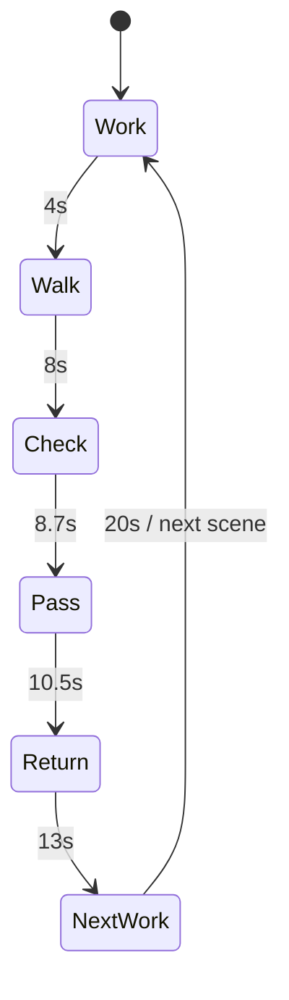

# 交互、动效与状态

此文档包含两个不同系统：首页是脚本化协作演示；客户和经营台办公室展示已保存的真实项目状态。两个系统共用形象，不共用“完成”判断。

## 六个可点击片段

| 片段 | 发起者 | 接收者 | 文件 | 关键说明 |
| --- | --- | --- | --- | --- |
| 01 接待想法 | Lumi | Nori | 需求卡 | 提交资料并启动免费分析，先交付机会报告 |
| 02 研究市场 | Nori | Fino | 证据卡 | Free 先交报告，Pro 服务确认后才进入策略 |
| 03 核对凭证 | Lumi | Milo | 付款凭证 | Milo 读取凭证，经营者核实实际到账 |
| 04 确定定位 | Fino | Kito | 定位方案 | 经营者把关且客户确认后，才准备页面 |
| 05 准备发布 | Kito | Pogo | 渠道行动卡 | 页面审批后公开，渠道执行与反馈另行记录 |
| 06 复盘反馈 | Pogo | Fino | 复盘报告 | 是否继续下一轮仍由经营者和客户决定 |

这是六段机制演示，不是一条不经确认就自动跑完的生产流水线。完整双语对白与人工确认说明来自 `content.zh-en.json`；不要只依赖截图或此表缩写。

## 单幕 20 秒时间轴

单位：毫秒；区间左闭右开。

| phase | 时间 | 画面与意义 |
| --- | --- | --- |
| 0 | 0-4000 | 发起者桌前处理任务；工作牌、敲键盘与职责工具出现 |
| 1 | 4000-8000 | 携带文件离开工位，沿走廊走向接收方 |
| 2 | 8000-8700 | 当面核对；两人的标题错层，避免相互遮挡 |
| 3 | 8700-10500 | 文件移交；9500 后显示接收确认，接收方成为当前角色 |
| 4 | 10500-13000 | 双方返回，接收方携带成果 |
| 5 | 13000-20000 | 接收方在自己的工位继续工作，保留七秒让用户看清 |

时长与路线配置：`src/lib/office-showcase.ts`、`src/components/office-showcase-canvas.ts`。文件从 8700 到 9500 过渡，接收确认不是业务审批。

## 操作与反馈

| 操作 | 反馈 |
| --- | --- |
| 点击六幕节点 | 切换片段、对白、双方形象与文件；从该片段开始播放 |
| 点击地图角色 | 切到该角色关联的协作片段 |
| 点击角色卡“观看协作” | 切片段、滚动到演示区，并将焦点交给演示区 |
| 点击“处理任务/当面交接/接手开工” | 跳到 0 / 8000 / 13000ms，并开始播放；减少动态时显示对应静态姿态 |
| 点击暂停 | 停止画面与工作条，保留标题、正文和当前状态 |
| 点击播放 | 从暂停位置继续 |
| 移动端手动查看地图 | 关闭镜头自动跟随，方便查看其他角色 |
| 点击“跟随当前 Agent” | 将当前角色重新置于可见区域并恢复跟随 |
| 切换中文/EN | 保留场景与时间位置，替换界面文案；客户填写和已有报告原文不翻译 |

## 性能与可访问性

- Canvas 最多 30fps，设备像素比上限 1.5；React 在片段/阶段变化时更新。
- 地图离屏、页面后台或手动暂停时取消后续动画帧；CSS 工作条跟随可见性与暂停状态。
- `prefers-reduced-motion: reduce` 下保留静态角色、文字、片段与阶段选择，取消空间运动和循环。
- Canvas 为辅助视觉且 `aria-hidden`；名称、对白、文件、按钮和状态由 HTML 提供。
- 图片/Canvas 加载失败仍可读完整交接内容，保留静态角色与“重新加载动画”。
- 阶段导航与片段导航是两个概念；前者控制一幕内动作，后者更换协作主题。

## 真实项目办公室

输入来自 `OfficeGuideInput`：项目状态、真实运行 Agent、套餐/订单、凭证、审批闸门、暂停、失败来源、交付验收与查看者身份。只读展示函数不创建任务、不审批、不确认付款。

| 展示状态 | 依据 | 需要表达 |
| --- | --- | --- |
| working | 相应任务实际在运行；研究也识别 vision | 谁在做、具体任务和产物 |
| queued | 阶段已进入，任务尚未运行 | 排队等待，不用重复提交 |
| waiting | 等待另一方审批、到账或数据 | 在等谁/什么、何时继续 |
| action | 当前查看者需要决策 | 明确行动入口，跳到正确审批/付款/支持区域 |
| complete | 本阶段或交付已完成 | 已产出什么、是否由用户决定下一步 |
| paused | 已暂停且没有正在收尾的任务 | 恢复后才开始下一步 |
| failed | 当前步骤失败 | 保留已保存成果，查原因后重试 |
| closed | 已取消 | 不启动新任务 |

暂停时若任务还在运行，显示“正在收尾，之后暂停”，并不承诺继续启动下一步。`states.json` 提供中英文合成示例，可用于设计评审；不包含真实客户数据，也不能作为生产状态数据源。

真实客户地图点击闲置工位会显示职责、产物和“当前没有运行任务”；可以回到当前工位。经营台工位链接继续打开业务详情。首页纸张接收动画和项目的人工作业闸门必须保持区分。
