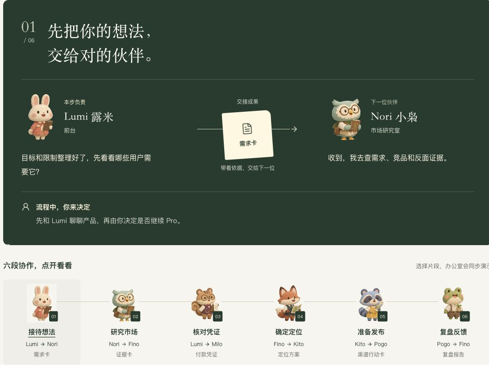

# 首客办公室 UI/UX 设计交付

交付日期：2026-11-08（Asia/Shanghai）。对象：前端工程师、UI/UX 设计师、产品验收。

这是一套**已实现页面的版本化交接包**。核心改动已通过 [`fe432a3`](https://github.com/kongleiwork-art/firstcustomer/commit/fe432a3) 上线；本包的源码、文案和截图基于 [`d2c09c9`](https://github.com/kongleiwork-art/firstcustomer/tree/d2c09c9258e3ebb7fb5465745a9df371e63a6e61)，包含同事追加的角色姓名悬停下划线和交接列宽均衡调整。后续 main 的业务更新不自动改写本快照。

## 建议阅读顺序

1. 下载相邻目录中的 [完整 ZIP](../FirstCustomer-Office-UIUX-Handoff-2026-11-08.zip)，解压后打开 `index.html`，无需安装依赖或联网。
2. 阅读 [六页 PDF](FirstCustomer-Office-UIUX-Handoff.pdf)，快速了解改动、桌面/移动端和动效分镜。
3. 设计走查用 [设计规范](DESIGN-SPEC.md)；开发对接用 [交互与状态](INTERACTION.md) 和 [组件与素材映射](IMPLEMENTATION.md)。
4. 按 [验收清单](ACCEPTANCE.md) 回归，文案使用 [双语内容快照](content.zh-en.json)，不要从截图反抄。

## 交付范围

| 改动 | 本次确定的表现 |
| --- | --- |
| 工作中标识 | 取消桌面/脚底光圈；上方任务牌、三条动态竖条、头部/手部动作和职责工具共同表达 |
| 办公室引导 | 当前任务、产物、下一位接手者、启动条件、用户决策直接可见 |
| 下方交接画面 | 深松绿底，左右角色与对白，中间文件和方向线，人工决策单独成行 |
| 六幕选择 | 六位动物组成连线导航，点击同步切换场景与对白 |
| 角色介绍 | 保持两列三行，明确名字、职责、产物与协作；保留最新姓名悬停下划线 |
| 完整服务路线 | Free 起点与可选 Pro 路线分开，里程碑绑定角色与说明 |

## 文件索引

| 文件 | 用途 |
| --- | --- |
| `index.html` | 可离线浏览、可编辑的交接展示页；不是完整网站 |
| `FirstCustomer-Office-UIUX-Handoff.pdf` | 六页评审与沟通文件 |
| `DESIGN-SPEC.md` | 色彩、字号、布局、断点、视觉层级 |
| `INTERACTION.md` | 六幕、20 秒时间轴、真实状态与演示的区分 |
| `IMPLEMENTATION.md` | 组件接口、源码入口、素材坐标及启动方式 |
| `ACCEPTANCE.md` | 验收步骤、已验证范围、已知后续项 |
| `content.zh-en.json` | 从实现中导出的角色、双语场景、对白、流程文案 |
| `tokens.json` | CSS 令牌与局部样式参数快照 |
| `states.json` | 从状态函数生成的合成示例，没有客户数据 |
| `source-manifest.json` | 源码快照 SHA-256、原仓库路径与固定版本链接 |
| `source/` | 18 份相关源码摘录；运行工程请克隆原仓库 |
| `assets/` | 原始办公室背景、动作图集、角色插画图集 |
| `screens/` | 12 张实际浏览器截图及采集尺寸、阶段记录 |
| `manifest.json` | 包内文件的 SHA-256 校验清单 |
| `VALIDATION.json` | 文件、PDF 与离线审阅页的交付检查记录 |

## 交接说明

- [线上办公室](https://hifirst.vercel.app/#office) 用于查看当前发布版本；复核本快照时以固定提交及 `screens/capture-metadata.json` 为准。
- 此包是可编辑的 HTML、Markdown、JSON、源码与原素材，PDF 和截图用于评审。HTML、Markdown、JSON 和 TSX/CSS 是可继续编辑的交付源。
- 本包没有环境变量、API Key、真实项目专属链接、付款资料或客户记录。
- 设计师可继续细化视觉，前端应保留真实状态判断、人工确认、语言切换、暂停和减少动态路径。
- 接收人/签收日期：________ / ________。转交时请团队填写接收人和日期。
