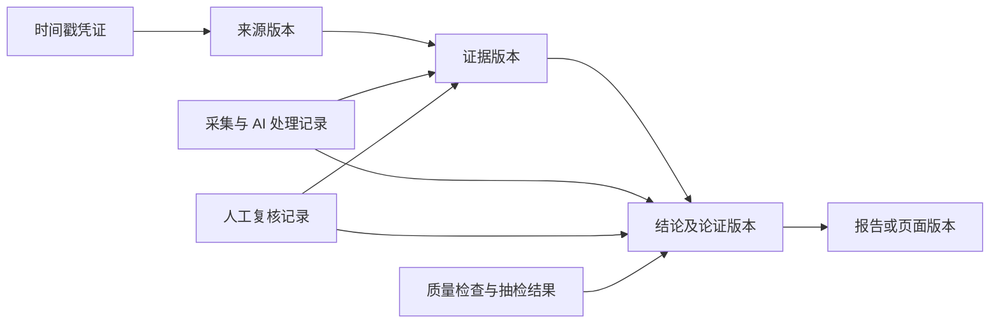

# 首客：八维可信性与软件质量验收规范

日期：2026-11-08（北京时间）  
状态：产品要求与首轮代码差距评估；不是八维验收通过报告。  
范围：项目登记 → 资料采集 → AI 研究 → 定位与结论 → 页面声明 → 交付与复盘。

## 1. 验证目标与边界

首客应能回答：结论依据什么、资料如何核对、是否适合当前项目、推理有哪些限制、材料变更后是否重新判断，以及软件是否可靠执行这些规则。

八个维度包含技术规范、质量模型、研究框架和组织机制，共同构成证据与结论的质量要求。它们不能简单相加为“可信度总分”，也不能以名称或标签代替实际检查结果。

软件质量另设测试层。ISO/IEC 25012 用于数据质量要求和评价；ISO/IEC 25010:2023 用于产品质量要求和评价。八维检查不能替代运行可靠性、安全性、性能和交互等测试。本规范是项目自定验收要求，不是对 ISO 全文的逐条符合性评估。[ISO/IEC 25012](https://www.iso.org/standard/35736.html)、[ISO/IEC 25010](https://www.iso.org/standard/78176.html)

| 验收对象 | 要回答的问题 | 不能据此推断 |
| --- | --- | --- |
| 原文核对 | 摘录是否来自保存的来源版本，数字、单位、主体和时间是否一致？ | 来源陈述一定属实 |
| 任务适用性 | 人群、市场、阶段、场景和时间是否匹配项目？ | 相似产品必然有相同结果 |
| 结论支持程度 | 全部相关证据、反证和限制允许说到什么程度？ | 评级等于商业成功概率 |
| 软件执行质量 | 是否正确拦截、隔离、留痕并从故障恢复？ | 产品已经产生商业成效 |

## 2. 现有实现与缺口

本次检查本地工作区，包含既有未提交改动；不据此断言线上部署状态。“部分基础”只描述实现，不表示该维度已通过验收。

| 维度 | 当前基础 | 必须补齐 | 本轮判断 |
| --- | --- | --- | --- |
| 1. W3C PROV | 来源 URL、摘录、采集者、任务输入输出、模型和需求范围版本 | 不可变来源版本、处理关联、逐结论引用链及断链检测 | 部分基础 |
| 2. ISO/IEC 25012 | 摘录匹配、按类型过期、许可与项目检查 | 质量指标口径、事实与语义抽检、异常处置记录 | 部分基础 |
| 3. 独立第三方抽检 | 内部审批与经营操作记录 | 外部核查方、利益关系声明、抽样清单、独立结果和整改复检 | 检查范围内未见机制 |
| 4. RFC 3161 | 工作包已有用于检查版本变化的 SHA-256 摘要 | 证据版本文件、TSA 时间戳令牌、签名与信任链验证 | 检查范围内未见接入 |
| 5. Wang–Strong | 候选人群、类别、定位说明与项目范围 | 项目条件与证据适用条件逐项比较、未知项、相关性标注集 | 部分基础 |
| 6. Toulmin | 研究与定位理由、反向检索、反证回应 | 逐项结论的完整论证记录、适用条件、反证影响测试 | 部分基础 |
| 7. 聚合与区分效度 | pain/pricing/revenue/signal 等分类，部分检索与引用去重 | 原始事件归组、方法独立性、痛点/试用/购买/续费区分评测 | 部分基础 |
| 8. 结论确定性 | 未知项、样本不足判定；另有 A–E 来源等级 | 独立的结论支持程度、逐因素理由、双人复核和评级历史 | 尚未建立所需评价机制 |

关键代码依据：

- [证据核对与等级](../firstcustomer/src/domain/evidence.ts)：`verifyQuote` 检查规范化后的摘录是否出现；`gradeFor` 按类型、域名和授权标志分类。它们不检查结论是否由证据推出。“客户授权”本身也不能证明支付事实，不能据此宣称已核实交易。
- [来源缓存](../firstcustomer/src/agents/tools.ts)与[数据结构](../firstcustomer/src/db/schema.ts)：`cacheDocument` 对相同 URL 更新正文；证据没有绑定不可变来源版本。重新抓取后，历史引用无法仅靠该缓存恢复当时原文。
- [证据界面](../firstcustomer/src/components/project-details.tsx)：`EvidenceSection` 将摘录匹配显示为“已验证”。应改为“摘录已匹配”等精确状态，并单独展示人工复核及结论支持程度。
- [声明检查](../firstcustomer/src/domain/claims.ts)：核对绑定、存在性、项目权限、状态、许可和有效期；没有验证语义支持关系，也未证明登记声明覆盖了文案中的全部非数字事实。
- [反证检查](../firstcustomer/src/domain/counter.ts)与[输出结构](../firstcustomer/src/agents/schemas.ts)：已有理由和反证回应，仍需验证回应是否实质改变或合理限定判断。
- [工作包检查](../firstcustomer/src/workflow/work-packages.ts)与[实验判定](../firstcustomer/src/domain/experiment.ts)：已有成果检查、版本摘要和预设标准重算；摘要不是可信时间戳，达到留资标准不等于证明购买或续费。

## 3. 八维验收要求

以下为拟实施要求；测试编号不代表已执行或通过的测试记录。通过条件均为首客的工程要求，不是所引用标准规定的统一门槛。

### V1. 来源链：追溯到当时的材料

参考 PROV 的实体、活动和责任主体：原文、证据、结论及报告版本是实体；采集、提取、核对和生成是活动；人、机构或执行系统是责任主体。内部关系需有明确映射；声称符合 PROV 时，还须验证相应格式和约束。[PROV-DM](https://www.w3.org/TR/prov-dm/)、[PROV 约束](https://www.w3.org/TR/prov-constraints/)

- **记录与功能**：保存来源版本 ID、原始地址、采集时间、内容摘要、提取方式、任务 ID、模型与提示模板版本、复核者及时间。每项重要结论绑定证据版本，证据绑定具体来源版本；重新抓取产生新版本。未人工复核必须明确显示。“查看溯源”逐层打开证据、快照和处理记录，沿用项目权限。
- **V1-01**：引用不存在、无权使用或不属于当前范围的证据，拦截并留痕。
- **V1-02**：更新原网页或撤回关键材料，历史报告仍定位旧版本；当前受影响结论进入待复核。依法依约删除原件时，保留允许保留的删除与失效记录，不能继续显示链路完整。
- **通过条件**：发布范围内的重要结论全部有可检查的来源链；缺源、缺版本、越权引用不得作为确定性事实发布。

### V2. 数据质量：字段、事实和时效分别检查

本项目选取准确性、完整性、一致性、时效性和可追溯性建立指标，不将其视为 ISO/IEC 25012 的全部特性。[ISO/IEC 25012](https://www.iso.org/standard/35736.html)

- **记录与功能**：入库检查来源、摘录、采集时间、适用范围、材料类型、许可、版本和核对状态。未知值不补造成事实。数字同时核对数值、单位、主体、时间段和分母；不能因数字相同而通过。到期表示需要更新或重新评价，不自动认定历史材料虚假；当前不当引用应被阻止。
- **V2-01**：缺必填字段、单位错配、日期异常或引用已过期材料，进入待处理并限制使用。
- **V2-02**：摘录匹配但断章取义、来源虚假或张冠李戴，事实/语义复核应记录问题；不能把匹配状态合并成“真实”。
- **通过条件**：硬性字段与使用规则全部执行；人工抽检有分母、不可判断数和错误实例。没有金标准或外部事实依据时，只报告一致性或支持关系，不命名为真实性准确率。

### V3. 独立核查：外部人员检查实际结果

这是产品治理机制，不是统一的认证名称。

- **记录与功能**：由未参与采集、生成和该轮内部审核的外部人员执行，披露身份、经验或资质、委托方、付款关系、利益冲突及范围。内部另一名员工或另一个 AI 不算独立第三方。抽样前固定总体清单、时间窗、版本、分层规则、选择方法和样本量；风险定向样本与随机样本分开。逐例保存问题、修正和复检，公开经授权的脱敏实例。
- **V3-01**：能从冻结清单及规则复现选样；事后替换或剔除失败样本使该轮记录不合格。
- **V3-02**：修正记录可回查原结果、问题、修订和独立复检；未修复问题不能标记关闭。
- **通过条件**：实际开展核查并留有可检查结果。未开展时显示“未开展”，结论仅覆盖约定总体及样本所支持的范围。

### V4. 时间与完整性：识别保存后的改动

RFC 3161 通过 TSA 签发的令牌关联消息摘要与时间；验证需检查签名、证书及信任策略，不能只比较哈希。它支持证明相应数据在有关时间点已存在，不证明内容属实。[RFC 3161](https://www.rfc-editor.org/rfc/rfc3161.html)

- **记录与功能**：固定存证的字节对象与序列化方式，保存文件版本、摘要算法及摘要、令牌、TSA 信息、请求/响应关联和验证结果。原始文件与提取正文分别标识；修改创建新版本。详情提供有权访问的文件、凭证和复核说明。TSA 不可用时显示未取得可信时间戳，本地时间不能替代。
- **V4-01**：合法文件及令牌验证成功；改变一个字节或换文件后验证失败。
- **V4-02**：错误摘要、无效签名、不受信证书、请求不匹配和服务超时分别有明确结果，失败不显示成功。
- **通过条件**：预先列入存证范围的每个版本有实际令牌和可复验结果；未接入时该项保持未完成。

### V5. 任务适用性：真实材料也可能不适用

Wang–Strong 将数据质量扩展到内在、情境、表达和可访问等方面，本项目据此检查资料是否适合当前决策。[Wang–Strong 原文](https://web.mit.edu/tdqm/www/tdqmpub/beyondaccuracy_files/beyondaccuracy.html)

- **记录与功能**：证据详情并列展示项目和材料的目标人群、地区、语言、产品阶段、场景及时间，每项显示匹配、不匹配或未知及依据。重要差异进入结论限制，不能仅因关键词相同就跨市场使用。
- **V5-01**：将美国企业采购材料用于中国个人消费者，标明差异；未知条件不补成匹配。
- **V5-02**：在按项目/来源分组隔离的人工标注测试集上，记录相关性判断、误用和不可判断案例。
- **通过条件**：适用条件齐全，重大不匹配未被隐藏；另有判断质量实测记录，字段存在不算判断正确。

### V6. 论证：说明证据如何支持结论

以主张、依据、推理保证、支撑、限定和反驳组织重要结论。保存可审阅的论证摘要与证据，不要求输出模型内部思维过程。结构完整不能保证推理正确。[Toulmin《The Uses of Argument》](https://www.cambridge.org/core/books/the-uses-of-argument/26CF801BC12004587B66778297D5567C)

- **记录与功能**：每项结论保存主张、支持/反对证据、推理理由、理由依据、适用条件、未知项和下一步验证行动；没有找到反证时显示检索范围及结果，不填成“无反证”。通过“查看判断依据”展示。缺依据的判断可保留为待验证假设。
- **V6-01**：仅有价格抱怨不能推出愿意购买本产品，语义复核须识别推理跳跃。
- **V6-02**：移除唯一关键依据或加入足以动摇判断的可信反证，触发重评并合理降级、修改或撤回；若结论不变，记录仍成立的独立依据。重复或无关材料不应造成无理由变动。
- **通过条件**：论证记录完整且关键推理通过复核；不能只检查字段非空或反证回复数量。

### V7. 交叉验证：区分概念与独立来源

聚合与区分效度涉及同一概念的多方法测量及不同概念的区分；来源去重和分类测试只是本项目的基础检查。正式的构念效度主张还需要测量模型、样本和适当统计验证。[Campbell–Fiske 原始论文](https://languagetesting.info/articles/store/C%26F1959.pdf)

- **记录与功能**：区分痛点表达、试用、购买意向、实际购买和续费及其测量方法。留资不是购买，竞品标价不是成交，自述收入不是直接核对的交易。同一事件转载或同一数据集派生报告归组，独立性不明显示未知。展示方法分布、原始来源组数和冲突；跨方法比较应限定同一概念、人群和时间。
- **V7-01**：三篇转载同一收入自述计为一个原始来源组，无法追溯时不自动认定独立。
- **V7-02**：对抱怨、试用、意向、支付、续费进行盲标对照，输出混淆矩阵；同概念证据不一致时保留冲突，不能用来源数量消除反证。
- **通过条件**：固定关键误判案例全部正确处理；独立性和概念区分有实测记录，来源数量不直接提高真实性评级。

### V8. 结论支持程度：表达与证据相称的确定性

参考 GRADE 对偏倚、不一致、间接性、不精确性和发表偏倚的考虑，建立首客的商业证据评价规则。GRADE 工作组对声称使用 GRADE 有明确条件，并不鼓励任意修改后仍使用其名称。因此产品显示“结论支持程度（首客规则）”，方法说明注明参考关系，不宣称 GRADE 认证或已严格实施 GRADE。[GRADE 使用条件](https://gradeworkinggroup.org/docs/Criteria_for_using_GRADE_2016-04-05.pdf)、[Cochrane GRADE 说明](https://www.cochrane.org/authors/handbooks-and-manuals/handbook/current/chapter-14)

- **记录与功能**：原文核对、来源/付费材料分类、结论支持程度分开存储；现有 A–E 不是 GRADE，不自动映射确定性。按具体结论及证据集合，记录偏倚、利益关系、冲突、适用差异、样本与测量不确定性、选择性披露，保留规则版本、理由、审核者和日期。可用“较充分 / 有限 / 不足”，另设未评价和待复核状态；等级定义经过案例校准后启用，等级不表示概率。
- **复核机制**：两位审核者先独立评价抽样结论，再保存原始分歧和裁决；内部双人复核与 V3 外部核查分别计数。
- **V8-01**：摘录匹配但仅有单个自述或间接人群材料，不能因匹配成功或来源等级较高自动获得充分支持。
- **V8-02**：关键证据新增、过期、纠错或撤回，使受影响评价进入待复核；保存旧新评级、理由和证据集合版本。
- **通过条件**：重要结论有按规则产生的评价或明确未完成状态；未评价、待复核不显示通过。

## 4. 数据与页面承载

以下为待实现设计，应先保存原文版本，再建设完整溯源界面，避免新增按钮后仍引用可覆盖缓存。

在现有任务、证据、报告表上，逐步补充来源版本、处理关联、结论与证据多对多关系、适用条件、原始来源组、评价历史、时间戳凭证和检查记录。

| 页面 | 展示内容 | 显示通过的前提 |
| --- | --- | --- |
| 证据详情 | 摘录匹配、人工核对、采集时间、适用条件、来源版本及存证状态 | 各状态分别有实际记录 |
| 结论详情 | 查看溯源、判断依据、评级理由、反证和未知项 | 当前证据集合与评价版本一致 |
| 项目质量页 | 检查结果、口径、待处理项与修正记录 | 读取程序/人工检查结果，不由模型生成分数 |
| 外部抽检页 | 核查方、范围、方法、样本量、结果和整改 | 已实际开展，公开内容获得授权 |

检查结果保存对象与版本、规则版本、执行时间、执行者/程序版本、结果、原因和证据引用。统一状态为“未执行 / 通过 / 不通过 / 待复核 / 不适用”；不适用需有理由，不计作通过。新结果不覆盖历史，公开入口不绕过项目及原文访问权限。

## 5. 指标与抽样口径

指标显示统计范围、时间窗、规则版本、分子、分母、排除项和运行时间。分母为零显示“无可评估样本”，不得显示 100%。

| 指标 | 计算口径 | 限制 |
| --- | --- | --- |
| 必填字段完整率 | 满足全部适用必填要求的证据数 / 范围内证据总数 | 提供字段级缺失清单，占位文本不算有效值 |
| 来源链完整率 | 能追到可检查来源版本和处理记录的重要结论数 / 重要结论总数 | 重要结论清单事先固定，不能事后剔除失败项 |
| 过期引用率 | 当前待发布/有效结论引用的已过期去重证据版本数 / 全部去重引用版本数 | 与整个证据库的库存过期率分开 |
| 摘录匹配率 | 匹配来源版本的摘录数 / 被检查摘录数 | 不称为事实真实性准确率 |
| 事实/语义抽检符合率 | 复核正确的可判定样本数 / 全部可判定样本数 | 同时报告总样本、不可判断数及占比 |
| 错误接受率 | 错误或不适用材料被放行数 / 测试集中此类材料总数 | 另报误拒绝率及各类型结果 |
| 审核者一致率 | 裁决前两人评价一致的样本数 / 双人独立评价样本数 | 一致不等于正确，保留分歧；条件允许时补充加权 kappa 等统计 |
| 变更复核覆盖率 | 已生成复核任务的受影响结论数 / 应受影响结论总数 | 另报完成率和时延，创建任务不代表完成 |

首次试运行建议准备 100 个经人工审定的案例，事实核对、条件适用、概念区分、反证影响、来源独立性各 20 个。这是工程试验规模，不是统计充分性的证明。按来源/项目组隔离开发与保留测试集，防止同一事件转载泄漏；真实抽检与人工构造反例集分别报告。

评测固定模型、提示模板、规则、数据版本和调用配置，预先约定重复次数，报告全部运行及波动。模型或规则更新后重跑相关保留集。随机样本的比例给出适当置信区间；分层抽样按设计报告，定向样本不外推总体。

结构性规则全量检查：发布范围内必需字段、关键引用链、权限及有效期规则全部满足，不能用其他维度高分抵消断链或越权。语义质量、相关性和审核一致性先测基线，再按错误成本预先登记门槛；未设门槛或未实测不能声称达标。已知关键误判案例须全部拦截，但不能据此宣称线上零误判。

## 6. 补充软件质量测试

以下按首客业务风险选取，不声称覆盖 ISO/IEC 25010 全部特性。

| 性质 | 场景 | 通过依据 |
| --- | --- | --- |
| 功能正确性 | 缺源、过期、跨项目、旧范围、错误单位、伪造引用 | 核心规则用例符合预期，匹配和语义审查分开 |
| 运行可靠性 | 模型超时、来源失败、重复投递、租期失效、进程中断 | 无重复有效交付/实收/发布，状态可恢复，未知结果留痕 |
| 安全与隐私 | 游客/客户/经营者权限矩阵，私有原文与导出，来源中的恶意指令 | 拒绝越权，无跨项目泄漏，外部内容不能绕过审批或执行权限 |
| 备份恢复 | 恢复报告、来源版本与检查记录 | 恢复后引用和摘要一致，记录恢复时间与数据损失窗口 |
| 性能容量 | 声明并发、数据量和环境后测详情、质量页及分析队列 | 报告 p95、错误率、等待和处理时长；基线建立后确定 SLO |
| 交互兼容 | 手机、键盘、中英文、失败状态、打开来源及理解未知项 | 核心任务可完成，用户能分辨摘录匹配与结论支持 |
| 可维护与重现 | 迁移、规则变化、历史回放 | 历史语境可还原，变更有影响分析与回归；不要求随机模型逐字重复 |

## 7. 推进顺序与发布边界

1. **消除误解并固定原件**：精确命名摘录状态及 A–E 来源分类，建立来源快照、证据版本和引用完整性检查；缓存覆盖问题优先解决。
2. **校验判断质量**：补充适用条件、逐结论论证、来源归组、首客结论支持程度、人工复核和变更重评，建立保留测试集及项目质量页。
3. **补充外部可复验证明**：按约定范围接入 TSA，落实独立核查方、抽样与整改；凭证接入和实际外部核查分别验收。
4. **持续验证软件执行**：模型/规则更新跑回归，运行中检查过期及变更，开展故障恢复和权限测试，保存每轮结果。

内部试用版可展示未完成维度及限制。对外声明限定对象、版本、时间和验证范围：未开展外部抽检或未接入 TSA 时，不称“八维验证全部通过”。任何阶段都不能凭本规范或测试数量宣称获得 W3C、ISO 或 GRADE 认证。

## 8. 本次运行记录

本次完成相关文档、数据结构、采集、声明和工作包检查的代码审阅，核对官方说明或原始文献，并运行已有测试。新增的是验收规范与差距记录，上述待建功能尚未在本次实现或上线。

环境：Node v26.0.0、npm 11.15.0、Vitest 5.1.0。基准提交 `37f17f405f4aaf7ae2f0f693d93ee2f53dd5bfb8`，执行时包含既有未提交改动，不能仅凭该提交重现整个工作区。命令均在 `firstcustomer/` 执行。

| 时间（北京时间） | 命令 | 实测结果 | 范围 |
| --- | --- | --- | --- |
| 2026-11-08 01:19:04 | `npm test -- tests/domain.test.ts tests/sources.test.ts tests/auth.test.ts` | 3 个文件，48 项通过，耗时 552 ms | 领域规则、模拟来源接口和会话测试 |
| 2026-11-08 01:19:39 | `npm test -- tests/workflow.test.ts` | 1 个文件，58 项通过，耗时 2.54 s | 本地临时 PostgreSQL、模拟模型/来源的工作流测试 |

合计 106 项通过。这些测试验证现有程序行为，不能替代真实市场结论准确率评测、正式构念效度验证、独立第三方抽检、可信时间戳验证或生产可靠性测量。V1-01 至 V8-02 的新验收用例仍需逐项实现、执行和记录。
