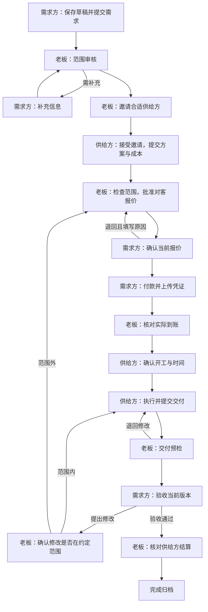

# OPC 双边委托：账号、权限、流程与交互设计

设计日期：2026-11-08。业务口径经本次对话明确：**需求方是提交项目委托的客户；供给方是承接委托的服务商或开发者；老板是经营首客 OPC 公司的实际负责人。**

本轮先完成工作流程和交互设计，同时落实老板账号与现有登录链路。供需协作原型为设计预览，不产生订单、支付或账号；新的双边交易模块尚未上线。现有出海初诊与 AI 项目继续运行，不自动转换成供需交易。

## 1. 角色与账户

| 身份 | 获取方式 | 可见范围 | 核心职责 |
| --- | --- | --- | --- |
| OPC 老板 | 部署时分配独立内部账号，禁止公开注册此角色 | 全公司委托、双方资料、价格、实收、成本、异常、日志 | 审核供应商、匹配、批价、核款、交付检查、异常裁决、结算 |
| 需求方 | 邮箱注册，默认可提交需求 | 自己的需求、对客报价、付款、交付、验收和沟通 | 说明目标与约束、确认范围和报价、付款、验收 |
| 供给方（申请中） | 注册后申请成为供给方 | 自己的资料与审核结果 | 提交能力、案例、可用时间；不得承接正式项目 |
| 供给方（已审核） | 老板审核通过 | 被邀请或被分配的委托；仅自己的方案、成本、交付和结算 | 评估范围、提出方案和成本、确认承接、交付、修改 |
| AI 员工 | 服务端任务身份，不分配交互登录账号 | 按任务限定的数据与工具 | 梳理需求、匹配建议、方案检查、报告；不能替人批价或确认收款 |

一个外部账号可以同时具备需求方和已审核供给方资格，工作台通过「我发起的 / 我承接的」切换。资格切换不能改变项目归属。首期不允许同一账号承接自己发起的委托。

老板现有独立账号保持使用 `ADMIN_USERNAME` / `ADMIN_PASSWORD`，服务端固定识别为 `owner`。没有公开的角色授予接口；页面参数、表单隐藏字段和客户 Cookie 都不能取得老板身份。密码文件仅保存在本机被 Git 忽略的位置，权限为 0600，界面不显示密码。

## 2. 权限矩阵

「本人项目」是服务端验证的资源归属，不是页面筛选；「受邀项目」不等于全平台项目。

| 行为 | 老板 | 需求方 | 已审核供给方 |
| --- | --- | --- | --- |
| 提交 / 修改需求草稿 | 可代建并标明代建 | 本人草稿 | 作为需求方时才可 |
| 确认需求范围 | 审核 | 本人确认 | 承接时确认执行范围 |
| 查看所有需求或联系人 | 经营权限 | 否 | 否 |
| 审核供给资格、邀请、改派 | 是，必须记录原因 | 可查看服务方身份 | 接受或拒绝自己的邀请 |
| 提交方案、成本和工期 | 可退回或备注 | 查看批准后的对客内容 | 自己的邀请 / 委托 |
| 查看其他供给方成本与方案 | 是 | 否 | 否 |
| 批准对客报价 | 是 | 否 | 否 |
| 接受 / 退回对客报价 | 不代客户确认 | 本人、当前版本 | 否 |
| 上传付款凭证 | 可代上传并标明操作者 | 本人订单 | 否 |
| 确认实收与差额 | 是，核对真实收款 | 否 | 否 |
| 更新执行进度、提交交付物 | 管理与检查 | 查看当前已共享成果 | 已确认分配且允许执行的项目 |
| 交付预检 / 对外送验 | 是 | 否 | 提交预检、按意见修改 |
| 确认验收 / 提出修改 | 不代客户验收 | 本人、当前交付版本 | 否 |
| 争议与暂停 | 受理、裁决、暂停 / 恢复 | 发起争议 | 发起争议 |
| 供给方结算 | 核对并记录实际支出 | 不可见成本明细 | 仅自己的应结和已结记录 |
| 收入、毛利与全公司报表 | 是 | 本人消费记录 | 本人结算记录 |
| 公司设置与权限分配 | 是 | 否 | 否 |

私人付款凭证不分享给供给方；供给方收款资料不分享给需求方。第三方附件下载也要校验当前会话与项目成员，不能只隐藏菜单。

## 3. 完整操作链

客户报价和供给成本分开保存。首期按「需求方向平台付款，平台核对后向供给方结算」设计，但不引入托管、自动分账或固定佣金比例；实际对客价、供应成本、结算条件由老板逐单确认。账面应付不等于已支出，退款请求不等于已退款。

## 4. 每一步的界面与交接

所有工作台共用一个委托编号、需求版本、报价版本和交付版本。页面顶部固定呈现「当前阶段 / 正在等谁 / 本次需要做什么」，按身份显示操作，不让双方猜测下一步。

| 状态 | 主要操作者与主按钮 | 其他人的反馈 | 完成后交接 |
| --- | --- | --- | --- |
| `draft` 草稿 | 需求方：保存草稿 / 提交需求 | 老板尚未接单 | 进入老板审核收件箱 |
| `triage` 范围审核 | 老板：确认范围 / 退回补充 | 需求方：正在审核，查看已提交需求 | 通过后准备邀请 |
| `needs_info` 待补充 | 需求方：逐项回答并提交 | 老板保留问题和之前回答 | 回到原审核任务，历史不清空 |
| `sourcing` 待供给方案 | 供给方：接受 / 拒绝邀请，提交方案与成本 | 需求方只见匹配进度；老板见每份邀请状态 | 有有效方案后进入批价 |
| `pricing_review` 待批价 | 老板：确认对客价格 / 退回方案 | 供给方看到自己方案的审核状态 | 生成不可静默修改的对客报价版本 |
| `quote_pending` 待客户确认 | 需求方：接受报价 / 退回修改 | 供给方等待正式分配，不提前开工 | 客户接受后显示支付信息 |
| `awaiting_payment` 待付款 | 需求方：上传凭证 | 老板：等待付款；供给方：未满足开工条件 | 进入核款待办 |
| `payment_review` 待核款 | 老板：确认到账 / 请补充凭证 | 双方：凭证核对中，不能视为已支付 | 实收记录与开工通知一并提交 |
| `start_pending` 待开工确认 | 供给方：确认开工时间 / 无法承接 | 需求方看到已付款、待服务方确认 | 进入执行；拒绝时回老板重新匹配 |
| `in_progress` 执行中 | 供给方：更新进度 / 提交交付 | 需求方可提问，老板可查看真实里程碑 | 进入交付预检 |
| `delivery_review` 交付预检 | 老板：送客户验收 / 退回修改 | 需求方：交付检查中 | 通过后客户收到验收任务 |
| `acceptance_pending` 待验收 | 需求方：确认验收 / 指出修改项 | 供给方：待客户确认 | 通过后进入结算；退回进入修改分流 |
| `changes_requested` 待修改处理 | 老板：范围内修改 / 发起范围变更 | 需求方与供给方看同一份修改意见 | 范围内回执行；变更需重新确认范围与报价 |
| `settlement_pending` 待结算 | 老板：核对并记录实际支付 | 供给方看应结与已结；需求方显示已验收 | 保存结算凭证后归档 |
| `completed` 已完成 | 双方：查看交付与记录；需求方可发起新委托 | 老板查看实收、成本和完整记录 | 不修改原订单来复购 |

暂停与争议是附加状态，不覆盖原阶段。暂停期间保留进度和沟通，阻止新开工、批价生效、付款确认和结算；恢复后回原阶段。已付款的取消、重新匹配或退款必须由老板处理，不能由一个「取消」按钮静默撤销账目。

**已付款后的改派与增减项：** 原实收和原交付范围保留。改派但范围、对客价和交付承诺不变时，老板重新邀请供给方，不再要求客户支付同一笔款。涉及范围、价格或交付承诺变化时生成独立变更单，老板先批准，再由需求方确认；仅对批准总价与净实收之间的差额发起补款。无差额则继续开工确认；出现超收则进入老板退款处置，实际退款需独立记录，不能把已收款记录删掉或改小。变更尚未确认时，双方都能查看旧约定，新增范围不能先执行。

改派完成后撤销原供给方的后续执行权限，但保留其已提交方案、已交付成果及自身结算记录的可见性；原供给方不能看到新供给方的报价、联系人或后续内部沟通。无法匹配时，需求方看到明确的老板处理状态与下一次更新时点，不能停留在无期限的「处理中」。

## 5. 关键交互效果

- **登录不中断：** 未登录打开受保护项目，登录完成回到原项目；不能登录后丢到首页，也不能把已过期登录误报为项目不存在。已登录但无资源权限仍显示不可访问，不泄露项目名称。
- **动作后看得见交接：** 成功提示说明保存了哪个版本、现在等谁；发起方的主按钮变成等待状态，接手方工作台增加真实待办。
- **报价退回：** 点击退回才展开原因；必填。老板看到被退回的版本与理由，重新批准生成新版本，之前的确认不自动沿用。
- **凭证与实收分开：** 上传成功显示「等待核对」，不显示「支付成功」。核款金额与报价不一致时必须填写差额原因。
- **交付退回：** 按交付清单选择未满足项，补充说明；始终保留原文件和版本。禁止以覆盖附件的方式改变已验收成果。
- **异常不失联：** 无供给响应、供给拒绝开工、任务失败、付款差异、验收争议均落到老板的明确待办；超时只提醒，不自动代替任何一方确认。
- **避免误触与重复操作：** 保存期间按钮禁用；后端仍以状态、版本、事务和幂等标识校验。两个窗口同时批价只产生一份有效决定。
- **双方消息有边界：** 通知只提供任务摘要和链接；真实权限在打开页面和提交动作时再次检查。未经邀请的供给方不能通过通知链接查看委托。
- **移动端同权：** 桌面双栏「项目 + 下一步」，手机改为上下排列；主操作保持可见，表单不会被固定底栏盖住。

## 6. 需要建设的功能

| 功能 | 界面 | 核心数据 / 校验 | 优先级 |
| --- | --- | --- | --- |
| 老板账号与明确权限 | `/admin/access` | 内部会话、服务器端能力清单 | 本轮落实 |
| 客户登录后回到原项目 | 客户登录、注册与账号项目页 | 站内白名单返回路径、资源归属 | 本轮落实 |
| 供给方入驻审核 | `/account/provider`；老板审核页 | 申请、审核状态、决定人、原因 | 双边模块 P0 |
| 需求方委托工作台 | `/account/requests`、`/requests/new` | 草稿、范围版本、预算与期望时间 | 双边模块 P0 |
| 供给方邀请与承接 | `/account/work` | 邀请有效期、受邀用户、方案与成本 | 双边模块 P0 |
| 批价与客户接受 | 老板审批页、委托详情 | 供给方案版本、对客报价版本、双重确认 | 双边模块 P0 |
| 收款与开工交接 | 委托财务页、老板核款 | 不变报价、付款记录、供给方开工确认 | 双边模块 P0 |
| 交付、修改、验收 | 同一委托详情的交付区 | 交付版本、清单、证据与客户决定 | 双边模块 P0 |
| 结算、争议与归档 | 老板财务与异常页 | 应付、实际支出、退款、裁决记录分离 | 双边模块 P0 |
| 通知与待办 | 三方工作台 | 同事务 outbox、重试、幂等消费 | 双边模块 P0 |

不一次性开多套重复后台。外部用户共用账号工作台，按项目参与身份显示「发起的委托 / 承接的工作」；老板继续使用现有经营台，新增委托业务页。

## 7. 后端模型与迁移边界

新增独立的 `engagements` 聚合，不改写现有 `projects` 的 AI 状态机。现有账号复用 `auth_users`；原有外部客户默认仍只能管理自己已有的出海项目。

建议新增：`provider_profiles`（资格及可用状态）、`engagements`（需求方和选定供给方、业务状态、暂停、版本）、`engagement_requirements`（范围历史）、`supplier_invitations`、`supplier_offers`（内部成本）、`client_quotes`（对客价格）、`engagement_payments`、`engagement_deliveries`、`engagement_decisions`（真实用户 ID、角色、对象版本、快照）、`supplier_settlements`、`outbox_events`。退款使用独立记录，不删除实收。

每次写操作依次检查：身份 → 资格 → 项目关系 → 当前状态 → 对象版本 → 必要材料 → 金额 / 文件合法性。业务写入、决定记录和待办事件应在同一事务提交，不能订单已推进却没有下一方通知。

旧专属链接仍服务现有出海项目；**新双边委托的批价接受、付款与验收必须用本人账号**，不把原客户专属链接直接作为多方协作授权。双边文件存储需私有访问检查。公开展示只使用脱敏后的委托摘要，默认不公开联系人、附件或报价。

## 8. 实施验收场景

1. 需求方 A 看不到 B 的委托；供给方只看到自己有效邀请或分配的委托。
2. 注册请求伪造 `owner`、修改页面角色、修改委托 ID 均不能获得新权限。
3. 供给资格撤销后，未开始邀请不可接受；执行中项目进入老板处置，不静默遗弃。
4. 老板批价后客户未接受，不能展示可支付订单；供给方不能先开工。
5. 上传凭证不会增加实收；两次并发核款仅产生一笔付款和一次开工通知。
6. 老报价 / 老交付页面提交确认时返回可恢复的版本冲突，不覆盖新成果。
7. 客户退回报价与交付时，各方看到一致的理由、版本与下一位负责人。
8. 模型失败、通知重试、供应商拒绝、需求取消均有确定的老板接手路径。
9. 实收、供给成本、应付、已付、退款分别统计；自有或测试委托不混入真实经营数字。
10. 桌面和手机均可完成需求、报价、付款、交付、修改与验收；刷新、重新登录后继续原委托。

这些是双边模块的验收规格，不能计为已通过的线上测试。本轮实际落地和测试结果另见提交说明与账号权限页面。
