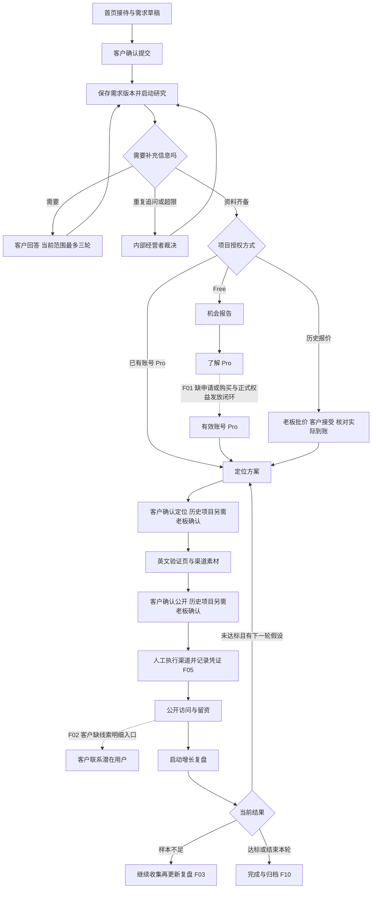

**首客 HiFirst 业务流程与卡点梳理 · 2026-11-08**

核心结论：系统已经连接了需求登记、研究、定位、页面生成和复盘的正常路径；距离客户能独立完成一笔业务，主要还缺升级开通、线索交接、复盘更新、公开链接延续和验收返工这五个闭环。部分问题来自账号 Pro 上线后，渠道执行、交付与异常处理仍沿用历史代运营流程。

本次梳理以当前本地源码及已有未提交修改为准，基准提交为 `9787752ea14a50bcca4f69011104c052adaeb9f8`。记录了 204 个 TS/TSX/CSS 源文件及相关测试、迁移等共 238 个文件的摘要，见[代码清单](evidence/code-manifest.json)。未修改应用业务代码或现有业务数据。

本轮重新执行既有回归：16 个文件、236 项全部通过。另用独立临时 PostgreSQL、模拟模型、受控来源和内存队列执行 9 项业务反例，均复现了预期调查的缺口。这里的“复现”不是通过业务验收，更不是线上故障发生率。正常路径测试通过与异常流程未闭环可以同时成立。

**当前真实业务边界**

| 使用者或流程 | 实际入口与能力 | 业务边界 |
| --- | --- | --- |
| 访客 / Free 客户 | 首页 Lumi → `/projects/new` → `/p/[token]`；账号归档在 `/account` | 登记、研究、补充信息、机会报告；不自动获得高级模块 |
| 账号 Pro 客户 | `/account/pro` → 同一个项目的研究、定位、发布与复盘模块 | 客户确认定位与公开发布，不要求老板进行初步报价或开通审核 |
| 历史项目报价服务 | 内部建项或既有报价项目 → 报价 → 客户接受 → 付款截图 → 老板核款 | 沿用历史合同与双方确认；项目密钥授权也继续采用双方确认 |
| 内部经营者 | `/admin`、`/admin/owner` | 历史报价收款、材料把关、人工异常、渠道记录、线索查看、经营报表和知识库 |
| 海外访客 | `/launch/[slug]` | 浏览已发布页、点击 CTA、自愿填写邮箱与留言 |
| 供给方 / 接单方 | 当前无生产业务入口 | 入驻、邀请承接、供应成本、结算等仍在[双边协作设计](../../docs/two-sided-workflow-design.md)阶段 |

Free 和 Pro 是客户权益，不是两类公司角色；动物员工是任务分工，不是可以登录接单的服务商。当前产品可以按“客户自助出海工作台 + 内部经营台”评估；若目标是供需交易平台，供给侧业务仍需要另行建设。

**从需求到结果的主流程**



新版页面发布还会影响已投放链接（F04）；正式交付后的修改意见需要返回执行（F06）。这两个回路目前均存在已复现的中断。

**各阶段由谁接手、在哪里停下**

| 阶段 / 状态 | 正常接手方和下一步 | 已有控制 | 卡点 |
| --- | --- | --- | --- |
| 草稿、`submitted` | 客户确认后，网页保存项目并派任务 | 草稿续填、输入校验、归属、需求版本 | 首次任务派发失败后，Free 的原项目启动按钮未接到已有 action，见 F09 |
| `researching` | 研究任务生成候选人群、证据与未知项 | 来源快照、当前范围隔离、证据摘录匹配 | 依赖模型、搜索和任务执行器；线上实时可用性本轮未测 |
| `needs_info` | 客户补充回答，全部完成后恢复研究 | 部分保存、版本检查、三轮限制 | 等待客户属正常人工节点；暂无站外提醒闭环 |
| `free_ready` | Free 阶段完成，客户选择是否继续 | 可查看报告、证据、修订有限范围 | 高级权益的正常获取链路缺失，见 F01 |
| `drafting_quote`、`awaiting_quote` | 历史流程由模型起草、老板批价 | 报价版本、老板决定和条款快照 | 属历史服务，不应重新套在账号 Pro 上 |
| `awaiting_quote_acceptance` | 历史客户接受或退回报价 | 双方决定与版本检查 | 开通账号权益可能改写已接受未付款订单，见 F07 |
| `awaiting_payment`、`reading_receipt` | 客户传凭证，老板核对实际到账 | 截图读取与实收分离、并发核款控制 | 人工核款是业务规则；退款处置另缺账务闭环 |
| `strategizing` | 策略任务生成定位及验证计划 | 回应反面材料、预设样本及判据 | Pro 范围变更无正式执行入口；替代定位方案也缺客户选择控件 |
| `awaiting_positioning` | 账号 Pro 客户确认；历史项目双方确认 | 当前版本校验、拒绝原因 | 确认事务与后续入队分开，失败可留下空转状态，见 F08 |
| `preparing_page` | 发布任务生成页面与渠道素材 | 声明结构、来源、许可、有效期检查 | 语义支持和数值语境仍有缺口，见 F11 |
| `awaiting_publish` | 客户预览确认后公开 | 公开前复查来源，旧确认不继承新版 | 新版改用新 URL，旧渠道链接失效，见 F04 |
| `published`、`collecting` | 人工执行渠道、收集数据；客户或老板启动复盘 | 访问、CTA、非测试留资与反馈计数 | 执行记录和外部反馈仍由老板操作，客户拿不到联系人，见 F02、F05 |
| `reviewing` 尚无报告 | 增长任务生成本轮报告 | 根据预设判据重算结果，模型不改写判定 | 复盘没有“继续收集后重算”回路，见 F03 |
| `reviewing` 已有报告 | 未达标且有假设可进入下一轮；结束本轮应归档 | 下一轮仍需客户确认 | 账号 Pro 结果完成但持久状态仍在执行中，见 F10 |
| `delivered` | 历史客户验收；有修改则应回到执行 | 成果签名和版本检查 | 退回只更新订单标记，项目不能返工，见 F06 |
| `awaiting_founder` | 老板查看超限原因并裁决 | 保留打回、澄清和裁决记录 | 属保留的异常路径，仍需明确响应责任与时限 |
| `failed` | 老板重试；账号 Pro 可从模块恢复部分失败 | 保留失败来源、已有材料、运行记录 | Free 重试 UI 脱节；入队失败未必进入此状态，见 F08、F09 |
| `cancelled` | 保留历史，停止后续业务推进 | 状态机禁止常规恢复 | 新委托或退款必须另走明确流程，当前缺正式账务处置 |
| `paused` 附加标记 | 停止新增执行，老板恢复 | 暂停与原业务阶段分开保存 | 普通客服也被停住，且老板不能接管排队消息，见 F12 |

**卡点清单与优先级**

P0 指直接影响核心价值或正式收费上线的闭环；P1 指特定分支会中断或改变已确认业务约定；P2 指完成状态、经营管理和持续使用的衔接问题。P0 不是对线上事故等级的判定。

| 编号 | 优先级 / 性质 | 卡在哪里 | 业务后果 | 最小处理方向 |
| --- | --- | --- | --- | --- |
| F01 | P0，待建设 / 待定价 | Free 报告 → 获取账号 Pro | 升级页只介绍权益并返回 Free；没有可审计的生产权益申请、发放、撤销入口 | 明确收费或邀请试用规则，先连通申请 → 经营者处理 → 权益历史 → 客户可见结果；在线购买可按商业安排后续接入 |
| F02 | P0，价值交付缺口 | 收到留资 → 客户跟进 | 客户只能看数量；邮箱、留言只有内部后台能看，核心获客成果需要线下转交 | 给所属客户提供线索列表、查看或导出，以及跟进状态；继续校验归属 |
| F03 | P0，已复现缺陷 | 样本不足 → 继续收集 → 更新复盘 | 一次过早复盘会固定旧结论，后续数据已达标也无法重算本轮 | 允许回到收集、生成新版本复盘，并绑定数据截止时间与实验版本 |
| F04 | P0，已复现缺陷 | 页面修改后再次发布 → 原渠道链接 | 旧 URL 不再解析；发过的帖子和分享会导向失效地址，当前复盘样本也切换到新页 | 固定对外项目 URL，或让历史 slug 跳转到有效版本；明确分版本 / 分轮统计，保留来源归因 |
| F05 | P1，自助职责未对齐 | 渠道素材 → 执行凭证 / 外部回复 | Pro 自助客户能看任务，不能登记自己发布的链接和反馈；内部仍承担录入工作 | 明确客户执行还是首客代运营；给负责方提供提交、核验和更正入口 |
| F06 | P1，已复现缺陷 | 已交付 → 客户提出修改 → 重新交付 | 系统收到了修改意见，但没有可执行的返工路线 | 增加范围内返工、范围外变更分流，创建新交付版本后重新核验与验收 |
| F07 | P1，已复现规则冲突 | 历史报价已接受 → 客户后来获得账号 Pro | 原待付款订单被改为账号权益订单，等待收款和合同审批语义被改变 | 默认保护已接受条款；需要切换时新增明确的变更决定与客户确认 |
| F08 | P1，已复现可靠性缺口 | 用户确认成功 → 后续任务入队失败 | 项目显示正在准备页面，但实际没有下一项工作；普通失败重试不适用 | 状态、决定、持久任务同事务提交，或使用可靠事件表；补“活跃状态但无任务”的恢复检查 |
| F09 | P1，源码确认 | Free 任务未入队 / 研究失败 → 重启原项目 | 后端启动 action 存在，页面却跳转首页 CTA，不能完成提示中承诺的原项目重新启动 | 将原项目的启动与重试表单接到已有 action，返回同项目当前状态 |
| F10 | P2，状态完成语义缺口 | Pro 复盘完成 → 本轮完成 / 归档 | 报告已达标，项目仍为 `reviewing`、订单交付仍为 `not_started`，持续算在活跃项目中 | 定义账号 Pro 的客户结束 / 自动完成规则，统一状态、列表、办公室与经营统计 |
| F11 | P1，已复现质量缺口 | 摘录匹配 / 引用绑定 → 结论获支持 | 相反含义和主体单位混淆仍能通过当前检查；用户可能将结构检查理解为事实核实 | 对关键声明明确语义核验与人工审核要求；数字同时绑定主体、单位和时间范围 |
| F12 | P1，已复现异常沟通缺口 | 项目暂停 → 客户询问进度 | 普通提问停在排队，老板也不能直接回复该排队消息 | 客服与执行暂停分开，允许经营者接管未回答消息并保留记录 |

F01 是当前明确保留的商业建设边界，不能当成偶发支付错误。F05 的人工渠道执行本身也合理；卡点在于自助 Pro 与内部经营者之间没有完整的操作交接。F10 的报告能够生成，问题在业务完成后的状态与持续使用。

**反例和源码定位**

1. **F03：已有新数据，旧复盘仍不能更新。** BP01 从账号 Pro 的正常研究、定位、发布路径进入复盘；第一次访问和留资为 0，生成“样本不足”。随后新增 25 个访问、2 个非测试留资，当前实验重算已达标，但报告仍保留 0 / 0。再次启动返回“不允许从 reviewing 流转到 reviewing”；重新执行推进器也不会更新报告。界面优先显示报告中的旧指标，影响客户对新增结果的理解。定位：[本轮报告存在就直接返回](/Users/kong/Documents/junction黑客松/firstcustomer/src/workflow/engine.ts:1145)、[启动复盘](/Users/kong/Documents/junction黑客松/firstcustomer/src/workflow/actions.ts:406)、[模块入口只从收集状态启动](/Users/kong/Documents/junction黑客松/firstcustomer/src/app/account/actions.ts:35)、[界面优先旧报告指标](/Users/kong/Documents/junction黑客松/firstcustomer/src/components/project-details.tsx:489)。

2. **F04：改版切断已投放链接，统计样本随版本切换。** BP05 在已有 25 个访问、2 条线索的公开页上创建并确认新版。旧 slug 的公开查询返回空，路由会显示 404；新版本的当前指标为 0。历史数据仍在旧页，不是数据库删除，但没有稳定入口及按实验归集的延续策略。定位：[新版生成新 slug](/Users/kong/Documents/junction黑客松/firstcustomer/src/workflow/landing-edits.ts:66)、[确认发布替换旧页](/Users/kong/Documents/junction黑客松/firstcustomer/src/workflow/actions.ts:376)、[公开查询只认 published](/Users/kong/Documents/junction黑客松/firstcustomer/src/workflow/queries.ts:240)。

3. **F06：拒绝验收以后，修改意见与执行脱节。** BP02 完成一条历史项目发布、复盘和交付路径，再提出修改。订单变成 `changes_requested`，项目仍为 `delivered`；修改验证页返回“项目当前无法修改验证页”，重新交付返回“不允许从 delivered 流转到 delivered”。现有回归仅验证“拒绝后可以再点通过”，没有覆盖实际返工。定位：[验收只更新订单交付状态](/Users/kong/Documents/junction黑客松/firstcustomer/src/workflow/actions.ts:450)、[delivered 没有后续流转](/Users/kong/Documents/junction黑客松/firstcustomer/src/domain/workflow.ts:112)、[页面编辑准入](/Users/kong/Documents/junction黑客松/firstcustomer/src/workflow/landing-edits.ts:28)。

4. **F07：账号开通改写已接受的历史报价。** BP03 使用“报价已接受、未付款”的受控历史状态：金额 29900 分、报价版本 2、项目在 `awaiting_payment`。客户已有有效 Pro 时进入模块，订单被直接改成 `account_active`，项目进入 `strategizing`，`requiresPayment` 变成 false，原报价数字仍留下。该反例针对已接受未付款合同，不涉及修改已经保存的实收记录。定位：[可转入的状态包含 awaiting_payment](/Users/kong/Documents/junction黑客松/firstcustomer/src/workflow/membership.ts:41)、[直接改写原订单](/Users/kong/Documents/junction黑客松/firstcustomer/src/workflow/membership.ts:43)。

5. **F08：确认已提交，入队失败却没有失败状态。** BP04 在客户确认定位时注入入队异常。函数返回错误，但数据库已进入 `preparing_page`，内存队列为 0；调用普通重试得到“项目不在失败状态”。账号 Pro 重新进入模块能够补发任务，这需要用户另做一次操作；历史流程、本地重启与云端恢复也不能据此当作已经自动补偿。定位：[决定和状态提交以后才入队](/Users/kong/Documents/junction黑客松/firstcustomer/src/workflow/actions.ts:311)、[普通重试只处理 failed](/Users/kong/Documents/junction黑客松/firstcustomer/src/workflow/actions.ts:481)、[Pro 模块的补发逻辑](/Users/kong/Documents/junction黑客松/firstcustomer/src/app/account/actions.ts:38)。此反例注入的是队列接口异常，没有测试真实 pg-boss 或云端队列故障。

6. **F10：自助复盘内容完成，项目状态没有结束。** BP06 在 25 个访问、2 条线索下生成“达到预设标准”，无下一轮假设，工作包核验通过。项目仍是 `reviewing`，订单为 `not_started`。Pro 页面没有客户结束或归档动作。内部经营台活跃数量仅排除 `cancelled`、`delivered`、`free_ready`，因此该项目仍计入活跃。定位：[增长任务只保存报告](/Users/kong/Documents/junction黑客松/firstcustomer/src/workflow/engine.ts:1143)、[Pro 模块动作](/Users/kong/Documents/junction黑客松/firstcustomer/src/app/account/actions.ts:23)、[内部活跃项目口径](/Users/kong/Documents/junction黑客松/firstcustomer/src/app/admin/owner/page.tsx:41)。

7. **F11：结构正确不能证明结论正确。** BP07 的原文“不愿为另一个笔记应用付费”与声明“客户愿意为我们的笔记应用付费”相反，摘录匹配和声明结构检查仍无违规项。BP08 的来源是“竞品每席每月 19 美元”，声明改成“本品收入增加 19%”，数字函数仍没有指出不受支持。两项在本轮当前源码上重新执行，延续此前质量报告的未关闭问题；没有证明它们已在完整发布链路对外出现，也没有测量人工审核拦截效果。定位：[声明只核对绑定等结构条件](/Users/kong/Documents/junction黑客松/firstcustomer/src/domain/claims.ts:52)、[数字仅比较出现过的数值](/Users/kong/Documents/junction黑客松/firstcustomer/src/domain/experiment.ts:66)。

8. **F12：暂停任务时也停止普通客服。** BP09 暂停项目后询问进度，消息成功保存并派发；推进器在处理客服前就因暂停返回。消息一直为 `queued`，经营者直接调用回复接口也因只接受 `escalated` / `replied` 而被拒绝。投诉等高风险问题走独立升级路径，不属于本反例。定位：[推进器提前返回](/Users/kong/Documents/junction黑客松/firstcustomer/src/workflow/engine.ts:1271)、[客服保存后派任务](/Users/kong/Documents/junction黑客松/firstcustomer/src/workflow/support.ts:28)、[人工回复准入](/Users/kong/Documents/junction黑客松/firstcustomer/src/workflow/support.ts:43)。

F01、F02、F05、F09 来自业务入口与调用链审阅，未伪装为模型运行实测：

- **F01：** [升级页](/Users/kong/Documents/junction黑客松/firstcustomer/src/app/account/upgrade/page.tsx:19)明确尚未定价和购买；现有生产代码读取账号权益并应用到项目，权益写入工具仅发现[测试账号初始化](/Users/kong/Documents/junction黑客松/firstcustomer/scripts/seed-test-accounts.ts:36)。旧的 `customerRequestProAction` 仍有定义，但没有客户界面调用，不能作为现行账号升级入口。
- **F02：** [线索明细查询](/Users/kong/Documents/junction黑客松/firstcustomer/src/workflow/queries.ts:204)只由[内部项目页](/Users/kong/Documents/junction黑客松/firstcustomer/src/app/admin/projects/[id]/page.tsx:154)调用；[邮箱与留言展示](/Users/kong/Documents/junction黑客松/firstcustomer/src/app/admin/projects/[id]/page.tsx:423)均在内部。客户页面读取的是聚合指标，没有线索明细或客户导出路由。
- **F05：** [渠道执行录入](/Users/kong/Documents/junction黑客松/firstcustomer/src/app/admin/projects/[id]/page.tsx:388)与[外部回复录入](/Users/kong/Documents/junction黑客松/firstcustomer/src/app/admin/projects/[id]/page.tsx:406)只在经营台。客户侧渠道区展示内容和状态，缺执行凭证、回复提交动作。没有自动向外部渠道发帖的执行器；页面已生成不等于渠道已触达用户。
- **F09：** [原项目启动 action](/Users/kong/Documents/junction黑客松/firstcustomer/src/app/p/[token]/actions.ts:70)在当前 `src` 中仅发现定义；[页面按钮](/Users/kong/Documents/junction黑客松/firstcustomer/src/app/p/[token]/page.tsx:156)实际指向 `/#cta`，与[提交异常提示](/Users/kong/Documents/junction黑客松/firstcustomer/src/app/projects/new/actions.ts:31)要求回工作台重新启动不一致。函数引用索引见[入口检索证据](evidence/entrypoint-references.json)。

**还需要补齐的业务规则**

- **Pro 的范围变更：** 当前需求修订只允许有限状态下的 Free 项目，Pro 被引导“联系经营者”，但经营者没有创建范围变更、让客户确认并使旧审批失效的正式操作链。参考[需求准入](/Users/kong/Documents/junction黑客松/firstcustomer/src/workflow/requirements.ts:7)。应明确范围内修改、范围外新单、补差价与旧版本保留，不能把客服回复视作需求已变更。
- **客户选择定位：** 客户看到多个定位选项，提交决定的 schema 没有 `chosenOption`，界面也没有选择控件；账号 Pro 因而只能直接接受推荐方案，或退回文字要求重做。业务层已支持选择索引，应把实际选择权接到客户确认动作。[客户决定表单解析](/Users/kong/Documents/junction黑客松/firstcustomer/src/app/p/[token]/actions.ts:25)、[业务层选项处理](/Users/kong/Documents/junction黑客松/firstcustomer/src/workflow/actions.ts:277)。
- **交接提醒与责任时限：** 已有经营台待办、运行超时和老板待办提醒，但依赖主动打开页面；没有完整的客户站外通知、送达失败重试与响应时限管理。跨越研究补充、定位确认、发布确认、核款和人工异常时，应至少记录负责人、待办原因、等待起点、承诺更新时间。
- **账号与财务售后：** 当前客户登录只有注册与登录，未发现可用的密码找回邮件链路。退款关键词会升级老板，但缺退款金额、审批、实际退付凭证与净收入归集的业务记录。正式收费时还应明确套餐额度、期限、可用模块、超额处理和权益恢复方式；这些属于商业运营规则待建设，不计作本轮线上事故。
- **双边市场：** 供给方资格、邀请承接、方案成本、开工、供给方交付和结算尚无生产模型和工作台。当前系统的 `projects` 与 AI 任务不能充当已上线的供需委托交易系统；如需要该业务，应按既有双边设计单独验收。

**建议的处理顺序与验收判据**

1. **先完成“发布 → 获客 → 客户跟进 → 更新复盘”。** 优先 F02、F03、F04、F05，同时明确 F11 的发布审核责任。用一位拥有项目的客户验证：获取线索明细、登记真实渠道链接、查看反馈；首次样本不足后继续采集，再生成绑定新数据截止时间的复盘；页面更新后，原分享地址仍能访问。所有联系方式只对正确项目成员开放。
2. **再完成异常恢复和返工。** 处理 F06、F07、F08、F09、F12。验收时注入入队失败、退回交付、暂停项目、已接受报价后开通权益等条件；每种情况都必须明确当前状态、下一位操作者和可执行的恢复动作，已接受条款不能被静默替换。
3. **对齐完成状态与正式开通。** 处理 F10 和 F01：结束本轮后，客户项目列表、内部活跃统计和办公室状态一致；客户获得 Pro 有可操作入口、明确处理状态和可审计的权益历史。定价未决时可以先建设邀请试用闭环；收费规则确定后再连接实际收款与权益发放。
4. **补长期运营。** 将 Pro 范围变更、定位方案选择、站外提醒、账号找回、退款处置和套餐额度纳入明确业务流程；双边市场另建验收清单。

业务完成不应只按“Agent 成功生成文件”判断。每一步至少同时回答：生成了哪个版本、谁可以查看、谁要确认、下一位负责人是谁、失败如何恢复。获客交付还需要客户拿到可跟进的真实线索；留资数量不能替代这次交接。

**验证证据和使用边界**

| 项目 | 本次结果 | 证据 |
| --- | --- | --- |
| 既有测试 | 16 个文件、236 项通过，约 5.24 秒 | [运行日志](evidence/tests.log) |
| 专项反例 | BP01–BP09 均复现调查的缺口；BP07、BP08 为现有质量问题复核 | [结果 JSON](evidence/flow-probes.json)、[执行脚本](evidence/flow-probes.mts)、[日志](evidence/flow-probes.log) |
| 代码范围 | 当前工作区文件摘要及关键函数引用 | [文件清单](evidence/code-manifest.json)、[调用位置](evidence/entrypoint-references.json) |
| 当前环境只读检查 | 北京时间 2026-11-08 07:20，本地 3100 未响应，配置数据库连接返回 `ECONNREFUSED` | [聚合快照](evidence/runtime.json)、[检查脚本](evidence/runtime-check.mts) |

当前环境检查说明本次不能直接观察现有项目积压多少或真实经营指标；独立测试数据库正常运行，两者不矛盾。发现 worker 进程也不能代替网页、数据库及任务执行健康检查。这不是生产站点停机的结论。

本轮没有对线上部署、真实模型、实时外部搜索、Vercel 队列回调、真实付款、真实渠道投放或真实客户转化重新验收。既有历史审计、设计规格、模拟数据均未计作本轮真实业务成果。未重新运行构建、Lint 或类型检查，既有报告中的这些结果不冒充本轮结果。

检查期间，工作区中的首页服务旅程组件和办公室样式有同期修改。已重新读取并确认其为展示层调整，不改变本报告引用的业务动作、状态机或上述卡点；初始及更新后的文件摘要与差异见[同期变更记录](evidence/source-drift.json)。

专项脚本第一次因中文目录的 URL 编码导致迁移路径解析失败，修正审计脚本为 `fileURLToPath` 后完整重跑；原日志保留为 [flow-probes-initial-harness.log](evidence/flow-probes-initial-harness.log)，该次失败不属于应用缺陷。最终 9 项结果以 `flow-probes.json` 为准。

复跑方式（在 `firstcustomer/` 执行；反例脚本不使用 `.env.local`）：

```bash
npm test
./node_modules/.bin/tsx --tsconfig tsconfig.json ../reports/business-flow-review-2026-11-08/evidence/flow-probes.mts
./node_modules/.bin/tsx --env-file-if-exists=.env.local --tsconfig tsconfig.json ../reports/business-flow-review-2026-11-08/evidence/runtime-check.mts
```
